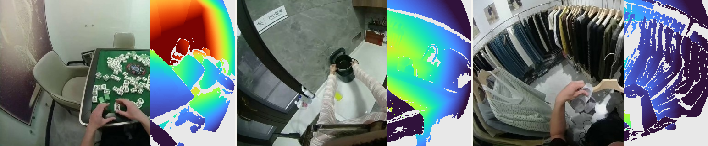

# EgoDepth-Bench

**Benchmarking Metric Depth for Egocentric Manipulation** · GenRobot

[Project page](https://egodepth-bench.github.io/) · [arXiv:2611.30734](https://arxiv.org/abs/2611.30734) · [PDF](https://arxiv.org/pdf/2611.30734) · [Dataset (Hugging Face)](https://huggingface.co/datasets/genrobot2025/EgoDepth-Bench) · [Evaluation code and quickstart](https://github.com/Chris004869/EgoDepth-Bench#recreate-the-paper-tables)

[](https://egodepth-bench.github.io/#sequence-gallery)

The evaluation repository includes the official scorer, adapters for 18 baseline models, and the archived paper results. To reproduce the tables using only Git and Python 3.10+, run

```bash
git clone --branch main --single-branch https://github.com/Chris004869/EgoDepth-Bench.git
cd EgoDepth-Bench
python scripts/export_archived_results.py --output outputs/tables
```

[Score your predictions](https://github.com/Chris004869/EgoDepth-Bench/blob/main/docs/EVALUATION.md) · [Run a baseline](https://github.com/Chris004869/EgoDepth-Bench/blob/main/docs/MODELS.md) · [Inspect the archived results](https://github.com/Chris004869/EgoDepth-Bench/tree/main/results)
